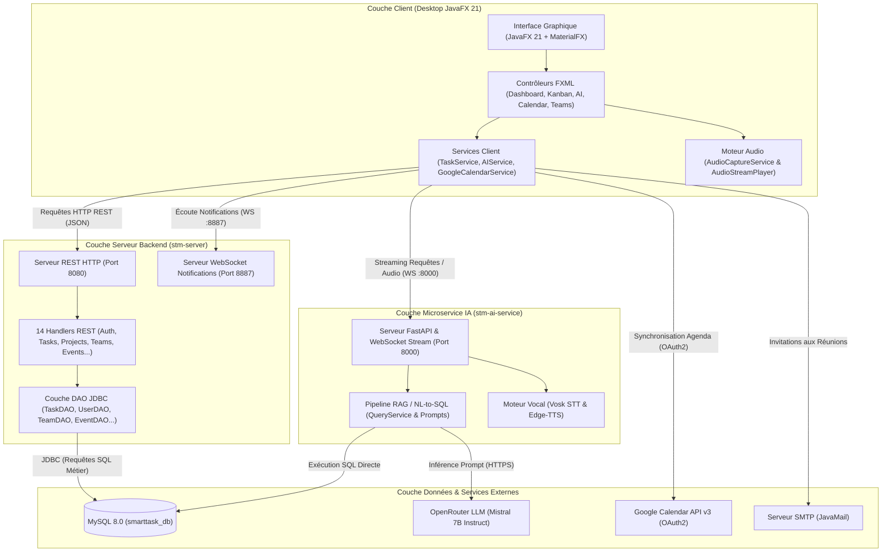
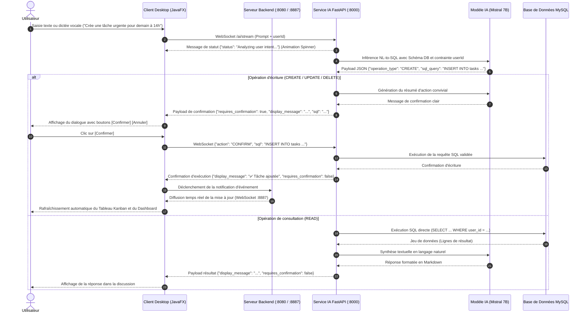

# Architecture du Système — Smart Task Manager

> Ce document décrit l'architecture technique, les choix de conception, les protocoles de communication et les flux de données de **Smart Task Manager**.

---

## 1. Vue d'ensemble (High-Level Design)

Smart Task Manager repose sur une architecture distribuée multi-tiers combinant :
- Un **client lourd desktop réactif** développé en **JavaFX 21** offrant une interface moderne (MaterialFX, drag-and-drop Kanban, tableau de bord KPI).
- Un **serveur backend central en Java 21** hébergeant à la fois une **API REST modulaire** (basée sur `com.sun.net.httpserver`) et un **serveur WebSocket dédié aux notifications instantanées** (`NotificationWebSocketServer`).
- Un **microservice d'Intelligence Artificielle en Python (FastAPI)** orchestrant l'interprétation en langage naturel, le pipeline **NL-to-SQL**, l'interaction vocale en streaming (Vosk & Edge-TTS) et l'inférence LLM (Mistral 7B via OpenRouter).
- Une **base de données relationnelle MySQL 8.0** hautement optimisée avec contraintes d'intégrité, clés étrangères et index composites.
- Des **intégrations tierces** : synchronisation bidirectionnelle avec l'API **Google Calendar v3 (OAuth2)** et envoi de courriels d'invitation/rappel via **JavaMail (SMTP)**.

---

## 2. Composants Principaux

| Composant | Technologie | Rôle & Responsabilités |
| :--- | :--- | :--- |
| **Client Desktop** (`stm-client`) | `Java 21`, `JavaFX 21`, `MaterialFX`, `CSS3` | Interface utilisateur graphique : Kanban drag-and-drop, Dashboard analytique, Agenda interactif, panneau d'assistant vocal/chat IA, gestion des sessions et streaming audio. |
| **API & Backend** (`stm-server`) | `Java 21`, `HttpServer`, `Java-WebSocket`, `JDBC` | Point d'entrée central des opérations métier : Authentification, gestion des tâches, projets, équipes, événements de calendrier, pièces jointes, suivi de temps et diffusion temps réel d'alertes via WebSockets. |
| **Microservice IA** (`stm-ai-service`) | `Python 3.11`, `FastAPI`, `Uvicorn`, `WebSockets` | Moteur d'assistance intelligent : Traduction requêtes naturelles vers SQL (`NL-to-SQL`), sécurité d'accès aux données utilisateur, exécution conditionnelle avec confirmation, reconnaissance vocale (`Vosk`) et synthèse vocale (`Edge-TTS`). |
| **Base de Données** (`smarttask_db`) | `MySQL 8.0` | Stockage relationnel transactionnel : 16 tables avec contraintes d'intégrité, suppression en cascade (`ON DELETE CASCADE`), index de performance et mise à jour dynamique de schéma (`SchemaUpdater`). |
| **Intégrations Externes** | `Google API v3`, `OpenRouter`, `JavaMail` | Synchronisation bidirectionnelle d'agenda avec Google Calendar, inférence d'intelligence artificielle distante et envoi automatisé d'e-mails pour les réunions planifiées. |

---

## 3. Flux de données (Data Workflow)

Le diagramme ci-dessous illustre le cycle de vie complet d'une commande utilisateur (vocale ou textuelle) adressée à l'assistant IA, incluant l'analyse d'intention, la génération SQL, la validation utilisateur et la notification en temps réel :

---

## 4. Modèle de données & Schéma Relationnel

La base de données relationnelle `smarttask_db` est organisée autour des entités centrales suivantes :

- **`users` :** Comptes utilisateurs, hachage sécurisé des mots de passe, noms/prénoms, tokens OAuth2 Google Calendar (`google_calendar_token`, `google_calendar_refresh_token`), fuseau horaire.
- **`tasks` :** Tâches principales avec titre, description, énumérations de priorité (`LOW`, `MEDIUM`, `HIGH`, `URGENT`), énumérations de statut (`TODO`, `IN_PROGRESS`, `COMPLETED`, `BLOCKED`), date d'échéance, association utilisateur (`user_id`), projet (`project_id`), tâche parente (`parent_task_id`) et récurrence.
- **`sub_tasks` :** Décomposition granulaire de sous-tâches rattachées à une tâche parente.
- **`task_tags` :** Association कई-à-plusieurs (Many-to-Many) entre tâches et tags textuels pour le filtrage et la catégorisation transversale.
- **`task_dependencies` :** Ordonnancement des tâches (`predecessor_id` vers `successor_id`) avec typologies de dépendance (`FINISH_TO_START`, `START_TO_START`, etc.).
- **`projects` :** Projets collectifs ou individuels avec code couleur, statut actif et propriétaire.
- **`teams`, `team_members`, `team_projects` :** Gestion collaborative : création d'équipes, attribution de rôles (`OWNER`, `ADMIN`, `MEMBER`) et affectation d'équipes aux projets.
- **`calendar_event` :** Événements d'agenda avec date, créneaux horaires, périodicité, liens de visioconférence (`meeting_link`, `meeting_platform`), visibilité et participants partagés.
- **`comments` & `comment_attachments` :** Fil de discussion contextuel par tâche et fichiers associés.
- **`attachments` :** Pièces jointes directement rattachées aux tâches avec métadonnées (`file_name`, `file_type`, `file_path`, `file_size`).
- **`time_tracking` :** Journalisation fine des temps de travail (`start_time`, `end_time`, `duration_ms`, `notes`).
- **`notifications` :** Alertes internes typées (`TASK_ASSIGNED`, `COMMENT_ADDED`, `DEADLINE_REMINDER`, `STATUS_CHANGE`...) avec état de lecture.
- **`shared_tasks` :** Partage individuel de tâches avec niveaux de permission fins (`READ`, `WRITE`, `ADMIN`).

---

## 5. Sécurité & Déploiement

- **Authentification & Sessions :** Gestion des sessions via `SessionManager` côté client, persistance locale des identifiants et vérification explicite des droits via `/api/auth/verify-password`.
- **Isolation Stricte des Données (Zero Data Leakage) :** Toutes les requêtes SQL générées dynamiquement par le service IA intègrent obligatoirement la clause de restriction `WHERE user_id = '{user_id}'`, interdisant l'accès aux données des autres utilisateurs.
- **Packaging Natif (`jpackage`) :**
  - **Windows :** Génération d'un installeur `.exe` autonome avec raccourcis bureau et menu Démarrer.
  - **Linux :** Création d'un paquet `.deb` intégré à la catégorie bureautique du système.
- **Conteneurisation & Cloud :** Le microservice IA est packagé sous forme de conteneur Docker léger (`python:3.11-slim`) avec installation de `ffmpeg`, prêt pour un déploiement PaaS (Railway / Docker Compose).
- **Intégration Continue (CI/CD) :** Pipeline GitHub Actions (`build-windows.yml`) automatisé déclenchant la compilation Maven et la création des installeurs multi-plateformes lors des poussées sur la branche principale.

---
[⬅ Retour au README principal](../README.md)